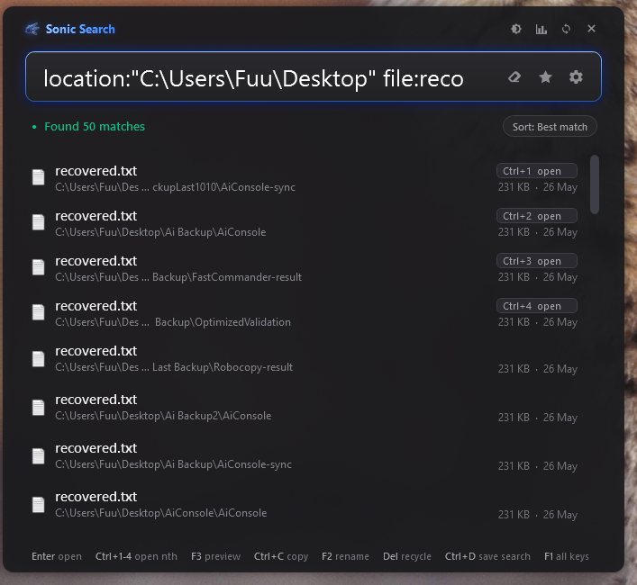
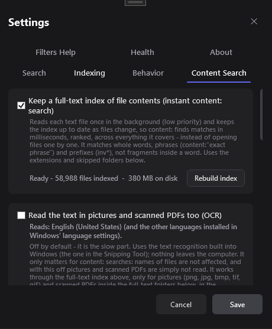
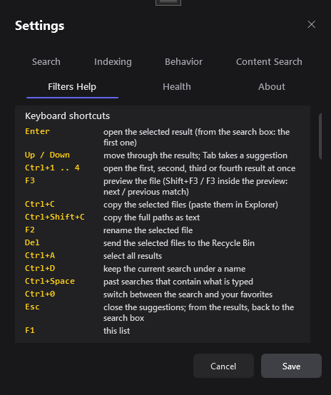
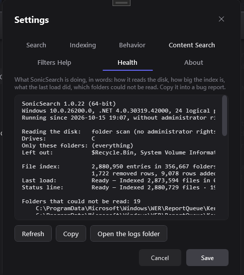

# Sonic Search

A very fast file search tool for NTFS drives on Windows. It reads the NTFS **Master File Table** directly, so it can index a whole drive in seconds, then search it as you type. It can also search *inside* files, including PDF, Word and Excel documents - and it does not need administrator rights.

## Download

**[Download the latest version](../../releases/latest)** (Windows 10/11, about 5.5 MB)

1. Open the link above and download `SonicSearch-win.zip`.
2. Unzip it anywhere (keep the whole folder together) and run `SonicSearch.exe`.
3. On the first start, choose how Sonic Search should read your disk (see [Without administrator rights](#without-administrator-rights)). The recommended choice needs one administrator prompt, once.

> The app is not code-signed yet, so Windows SmartScreen or Defender may show a warning the first time. Choose **More info**, then **Run anyway**.

## What it does

- **Instant search.** Results follow your typing. Matching modes: Contains, Starts with, Exact, Regex, and `*` / `?` wildcards.
- **Open the first four results with Ctrl+1 ... Ctrl+4.** The first four rows show the shortcut. Ctrl+0 switches between Search and Favorites.
- **Qualifiers you can combine:**

  | Qualifier | Example | Meaning |
  |---|---|---|
  | `ext:` / `type:` | `ext:pdf` | by file type |
  | `file:` / `folder:` | `folder: backup` | files only / folders only |
  | `name:` | `location:C:\windows name:system32` | the word is searched in the names (like typing it plain) |
  | `size:` | `size:>10mb` | by size |
  | `date:` / `modified:` | `date:>7d` | by modified date |
  | `location:` / `path:` / `in:` | `location:desktop` | inside a folder (or a well-known name such as Desktop, Downloads) |
  | `drive:` | `drive:d` | one drive only |
  | `content:` / `text:` | `content:"invoice 2024"` | search inside files |
  | `sort:` | `ext:mp4 sort:size` | put every match in order: `size`, `date`, `name`, `path`, `type` (add `-` to reverse) |

- **Full-text search in files.** Optional. Choose folders in Settings and Sonic Search builds a persistent index of the text in them, including **PDF, Word, Excel, PowerPoint and OpenDocument** files. `content:` searches answer in milliseconds, ranked by relevance. See [How fast is it?](#how-fast-is-it).
- **Combine words.** `report | invoice` (either), `report -draft` (not), `(jpg | png) -thumb` (groups), `"annual report"` (a phrase). It works with every qualifier above.
- **The best answer first, and Fuzzy mode.** The name that answers your word best is listed first (exact name, starts with it, starts a word, inside). In Fuzzy mode `rpt` finds `report`.
- **Saved searches.** Ctrl+D names the search in the box; clear the box to list them.
- **Actions on results.** Select several rows; Ctrl+C copies the files (paste in Explorer), F2 renames, Del sends to the Recycle Bin, Open With, Open Terminal Here, and you can drag the files out into Explorer or another program.
- **Disk usage and duplicates.** Folder sizes as a tree with each folder's share, the 300 largest files, and duplicate files (same size, then start and end, then the whole content) with "keep one copy" and Recycle Bin. Folder sizes appear in about 80 ms for 2.9 million files.
- **Updates from inside the program.** A few seconds after it starts, and every few hours while it runs in the tray, it looks at this releases page (can be turned off); an "Update available" button and one tray notice per version lead to a window that downloads and installs the new version and keeps your settings.
- **Sort and export.** `sort:size`, `sort:date`, ... or the Sort button next to the status line order *all* matches (`ext:mp4 sort:size` = the largest videos); the same menu saves the results as a CSV file for Excel.
- **A roomier result list.** Name, a shortened folder, and size and date on every row; under the mouse a row offers Open, Preview and Show in folder. The matched text of a `content:` search shows under the name; hover for the full path. A compact option fits more rows.
- **Text in pictures (OCR).** Optional: screenshots, scanned pages and PDFs that are only images become searchable with `content:`, using the text recognition built into Windows. Nothing leaves the computer.
- **Qualifiers become tags.** Type `name:erol` (or `name : erol`) and press Space: it turns into a tag under the search box. The x takes it away, a click on the tag changes it, Backspace in an empty box takes the last tag back into the box. The quick filters under the box (Documents, Images ...) are tags too. A second tag of the same kind joins or replaces the first: `ext:exe` + `ext:com` -> `ext:exe,com` (either), `content:erol` + `content:ayse` -> `content:(erol AND ayse)` (all of them), a second `location:`, `drive:`, `sort:`, `folder:`/`file:`, `size:` or `date:` replaces the first (`size:>1mb` and `size:<10mb` make a range), `name:` words add up.
- **Accents are ignored.** `ayse` finds Ayşe, `sirket` finds Şirket, `cafe` finds café, `isik` finds ışık - in names, `location:` and the full-text index. Settings > Search > Ignore accents (on by default).
- **English and Turkish (Türkçe).** Settings > Behavior > Language: Automatic (follows Windows), English or Türkçe; every window, menu and message is translated.
- **Notices in the corner.** Update, drive and "still running" notices appear in the bottom-right corner with the large icon, in the theme colours (no Windows balloon with a second small icon).
- **Light and dark theme.** The sun button in the title bar, or Settings > Behavior > Theme (Dark, Light, Follow Windows).
- **Search the folder you are in.** Optional (Settings > Behavior): press the hotkey while an Explorer window or the desktop is in front and the search is limited to that folder, shown as a chip next to the title (click its x to search everywhere again) - the search box stays free for your words. With several tabs it uses the tab in use.
- **Command line and Explorer menu.** `SonicSearch.exe report sort:size`, `SonicSearch.exe --in "D:\Photos" holiday`; an optional *Search with SonicSearch* entry in Explorer's right-click menu for folders and drives.
- **Keys at a glance.** A line under the results lists the main keys; F1 opens the full list. Keys such as F3, F2, Del and Ctrl+C act on the row the mouse points at.
- **USB and other drives.** Settings > Indexing lists every fixed and removable drive (USB disks are marked). Plug a drive in or take it out while the program runs and the results follow; a drive you did not choose is offered in a tray notice. FAT / exFAT sticks are searched by listing their folders.
- **Quick filters and recent files.** One-click chips under the search box (Documents, Images, Videos, Music, Archives, Folders, Today, Large); with nothing typed, the files that changed lately in your folders are listed.
- **Your own right-click actions.** Settings > Behavior: `Open in VS Code | code | "{path}"`, one per line, with `{path}`, `{folder}`, `{name}`, `{base}`, `{ext}`.
- **Health page** (Settings > Health): how the disk is read, index size, folders that could not be read, the full-text index, the service, memory, and Copy / Open logs for a bug report.
- **Preview panel (F3).** A panel beside the search window shows the selected result and follows it as you move through the list (the keyboard stays in the search box; the button in the title bar or F3 shows and hides it, and it is remembered). Source code with syntax highlighting, rendered Markdown, PDF and Office pages, with your search words highlighted and F3 / Shift+F3 to jump between matches. Programs and other binary files show a card with a sharp icon, version information, who signed it, size and dates. A folder shows a card too - or, with **Show contents**, a list of what is in it: details (sortable columns), list, icons or thumbnails, a search box that looks only in that folder, the Windows right-click menu, drag out, rename and delete, in the dark and light themes.
- **Live updates.** New, renamed and deleted files appear in the results within a fraction of a second, with no rescan. See [Live updates](#live-updates).
- **Several drives.** Pick which drives to index.
- **Favorites** in groups, with their own search box, and drag-and-drop from Explorer.
- **Most-opened first.** Files you open often rise to the top of the results.
- **Also finds** Windows tools (Device Manager, Services, ...) and Chrome / Edge bookmarks.
- **Global hotkey** (default Ctrl+S) to summon the window from anywhere; it lives in the system tray and can start with Windows.

| Keyboard shortcuts (F1) | Health page |
|---|---|
|  |  |

## How fast is it?

Measured on a 24-core Windows 11 PC with an NVMe SSD and 2.94 million files on `C:`:

| | |
|---|---|
| Search all 2.94 M file names, every match | 17-30 ms |
| The first 50 results (what the window shows) | under 1 ms |
| Start with a saved index | about 1 second |
| First scan of the drive | about 30 s (about 20-45 s without admin rights) |

Full-text search, 58,000 documents (PDF, Office, text), 228 MB index:

| | |
|---|---|
| `content:` a word in a few files | about 7 ms |
| `content:` a word in about 900 files, with snippets | about 100 ms |
| `content:` a very common word (over 2,000 files), with snippets | about 200 ms |
| Open the saved index | under a second |
| Build the index from scratch | about 3 minutes, in the background at low priority |
| Keep it up to date | a changed file is re-read within seconds; unchanged files are never re-read |

Fewer cores means proportionally slower scans; typing stays instant either way. Memory use is about 250-300 MB for 2.9 million files, most of it reclaimable.

## Live updates

| How the disk is read | What reports a change | When Sonic Search was closed |
|---|---|---|
| Indexing service, or Administrator | the NTFS change journal, within about 100 ms; the whole drive, renames and moves exact | changes are replayed at the next start |
| Without administrator rights | a file watcher on every scanned folder, applied once a second | folder times are compared at the next start (a few seconds, in the background) |

The full-text index follows the file list: a changed document is re-read within seconds, and the work pauses while you type.

## Without administrator rights

Reading the raw NTFS volume needs elevation, so Sonic Search offers three ways to read your disk on the first start (and **Settings > Indexing > Choose again...** later):

1. **Install the indexing service (recommended).** One administrator prompt, once. A small Windows service does the privileged reading; the window itself runs normally and accepts drag-and-drop from Explorer. Everything on the drive is found.
2. **Run as Administrator every time.** Nothing is installed; you get a UAC prompt at every start.
3. **Search without administrator rights.** No prompt, nothing installed: Sonic Search lists your folders itself. The first scan takes a minute or two and later starts are instant (the check against the disk runs in the background). Folders your account cannot open - other users' profiles, system areas - are left out, and the status line says how many. Changes made while Sonic Search was closed are picked up at the next start.

## Requirements

- Windows 10 or 11 with an NTFS-formatted drive.
- .NET Framework 4.8 (already part of current Windows 10 / 11).

## Known limits

- NTFS drives only (FAT / exFAT / network shares are not indexed).
- Without administrator rights or the service, files in folders your account cannot open are not found.
- Full-text search reads PDF, Word, Excel, PowerPoint, OpenDocument and RTF files itself - nothing needs to be installed. Scanned PDFs that contain only images have no text to find, encrypted files can't be read, and `.msg` e-mails depend on an installed filter.
- Not code-signed yet.

## Source code

The source code is not public. This repository only hosts the downloads and release notes.

Sonic Search includes `NtfsReader`, derived from Jeroen Kessels' JkDefrag and used under the LGPL-2.1.
